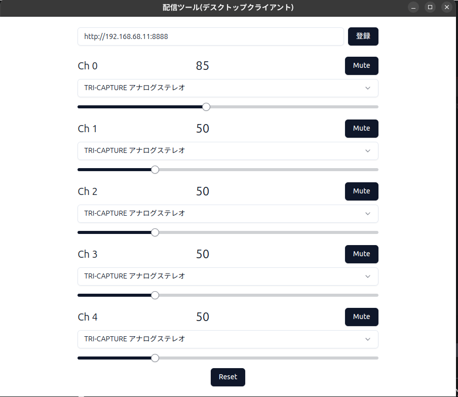
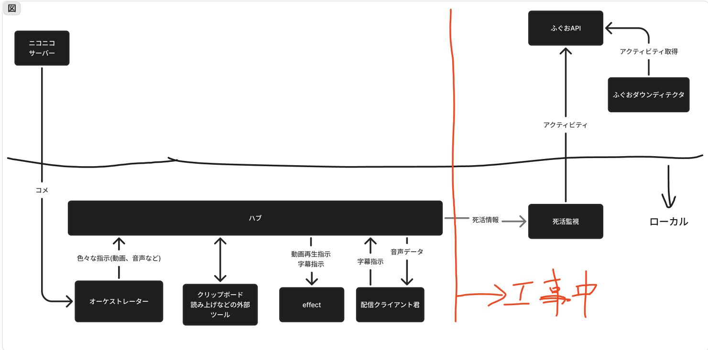

# livestream_kit
## なにこれ
このリポジトリは、[ふぐお](https://www.nicovideo.jp/user/98746932/live_programs)が配信中に使用している配信ツールです。

## 動画コマンドを追加したい方へ
`video`ディレクトリに使用したい動画のファイルを追加してください。
その動画のファイル名=コマンド名になります。  
その後、プルリクエストを送ってください。短めの動画だったら、多分マージします。  

## 使い方

### 1. VoicePeakのセットアップ
CLIで実行可能なVoicePeakのバイナリが入ったディレクトリを`./voicepeak/mountspace/Voicepeak/`に配置します。  
CLIが実行できるvoicepeakの実行ファイルが`./voicepeak/mountspace/Voicepeak/voicepeak`になるようにしてください。  

### 2. オーケストレーターのセットアップ
まず、以下のようにspotifyのAPIを使用するためのクレデンシャルを.envファイルに書き込んでください。  

```.env
SPOTIFY_CLIENT_ID=hogeID
SPOTIFY_CLIENT_SECRET=hogeSecret
SPOTIFY_REFRESH_TOKEN=hogeToken
```

.envはこのリポジトリのルートディレクトリに配置してください。  

次に、以下のコマンドでオーケストレーターとハブを起動します。

```bash
docker compose -f docker-compose..yml up orchestrator hub
```

### 3. デスクトップ配信クライアントのセットアップ

このリポジトリのリリースページにビルド済みのクライアントがあるので、ダウンロードして起動してください。  



上の画像のようなウィンドウが表示されます。  
URL欄にオーケストレーターのサーバーが立っている場所のアドレスを入力します。  

音声読み上げはCh0, エラーや接続情報はCh4に出力されます。  

### 4. エフェクトページのセットアップ
以下のコマンドでhtmlファイルをビルドします。  

```bash
# 依存関係のインストール
pnpm i

pnpm effect build
```

ビルドされたhtmlファイルを配信ソフトのブラウザソース等で読み込みます。  

### 5. OBSのデスクトップ音声ミュート

OBS 28以降のWebSocketサーバーを使い、アニメ再生中だけデスクトップ音声をミュートします。

OBSの「ツール」→「WebSocketサーバー設定」でサーバーを有効にし、認証を無効にしてください。既定のポートは`4455`です。

```bash
cli run ~/dev http://192.168.68.11:8888
```

アニメの再生イベント（`mediaInfo` / `kind: "anime"` / `playbackStatus: "Playing"`）を受け取るとミュートし、最後のイベントから10秒経つと解除します。

ミュート・解除を適用すると、`instSynthesize`をCh4へ送って「ミュートしました」「ミュート解除しました」と読み上げます。

音声ソース名はOBSの`GetSpecialInputs`から自動検出するため、日本語の「デスクトップ音声」もそのまま使えます。カスタムの音声出力キャプチャを使う場合は`--obs-input`で名前を指定してください。

| オプション | 既定値 | 説明 |
| --- | --- | --- |
| `--obs` / `--no-obs` | 有効 | OBS連携の有効・無効 |
| `--obs-url` | `ws://127.0.0.1:4455` | OBS WebSocketのURL |
| `--obs-input` | 自動検出 | ミュートする音声ソース名 |
| `--obs-unmute-delay` | `10` | イベントが止まってから解除するまでの秒数 |

環境変数`OBS_WEBSOCKET_URL`と`OBS_AUDIO_INPUT`でも指定できます。

### 6. マイクの無信号監視

配信開始から2分後にOBSのマイク入力を確認し、音声信号が来ていない場合はCh4で警告します。

OBSの「配信開始」ボタンが押されていないのに、ニコニコ/YouTube側で配信開始を検知した場合は、15秒後に警告します。

マイク音声ソースは`GetSpecialInputs`から自動検出します。カスタムの音声入力を使う場合は`--obs-mic`で名前を指定してください。

| オプション | 既定値 | 説明 |
| --- | --- | --- |
| `--mic` / `--no-mic` | 有効 | マイク監視の有効・無効 |
| `--obs-mic` | 自動検出 | 監視するマイク音声ソース名 |
| `--mic-check-delay` | `120` | 配信開始から確認するまでの秒数 |

環境変数`OBS_MIC_INPUT`でも指定できます。

## システム図

  

[細かい技術的詳細はここから](https://qiita.com/boxfish_jp/items/703f8dc2d4674bf6802b)

もし、なにか疑問等あれば、Issueやニコ生のコメント、TwitterのDM等でお知らせください。  
